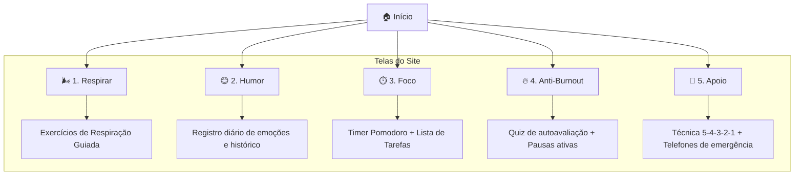
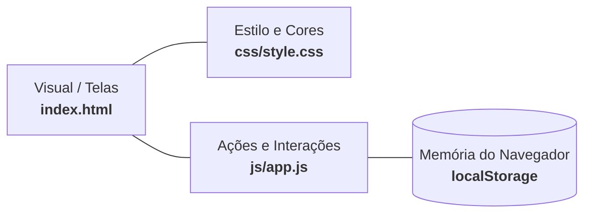

# 🗺️ Mapa Simplificado do Site — Mente Leve

O site é uma **SPA (Single Page Application)** simples: tudo roda em uma única página HTML, alternando as telas pelo menu.

---

### 1. Mapa de Telas (Navegação)

---

### 2. Como o Site Funciona (Camadas Básicas)

* **[index.html](file:///c:/Users/aluno/Downloads/Jovens/Jovens/index.html)**: Guarda todo o texto, botões e as 6 telas.
* **[style.css](file:///c:/Users/aluno/Downloads/Jovens/Jovens/css/style.css)**: Cuida do visual, animações e dos 3 modos (escuro, claro e alto contraste).
* **[app.js](file:///c:/Users/aluno/Downloads/Jovens/Jovens/js/app.js)**: Troca as telas quando você clica no menu e faz o cronômetro, gráficos e quiz funcionarem.
* **`localStorage`**: Salva tarefas e registros de humor direto no computador/celular do usuário (sem precisar de cadastro ou banco de dados).
